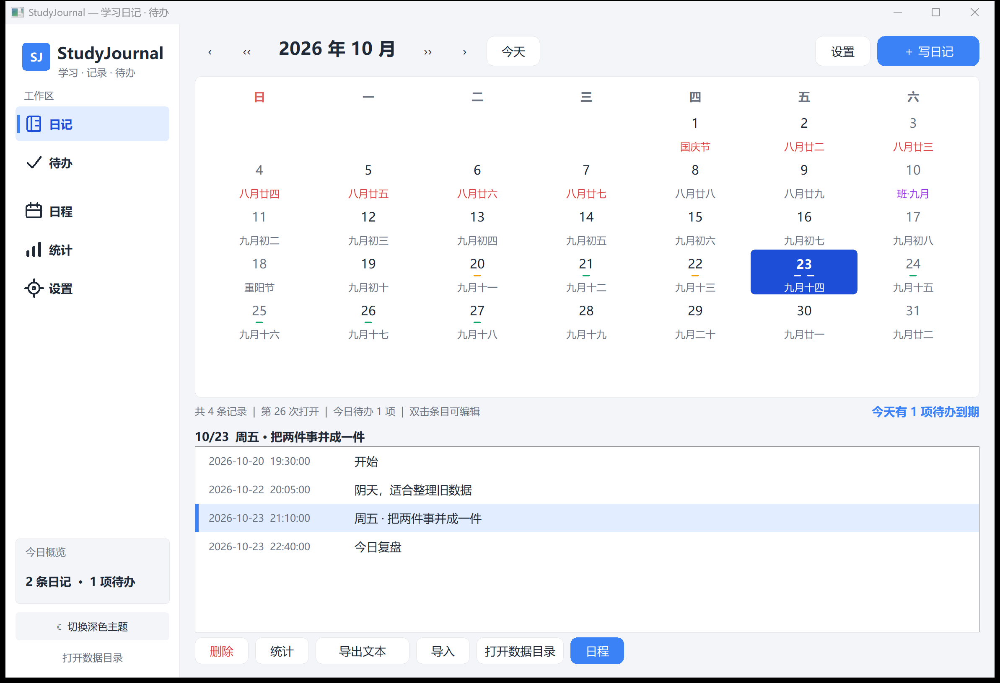
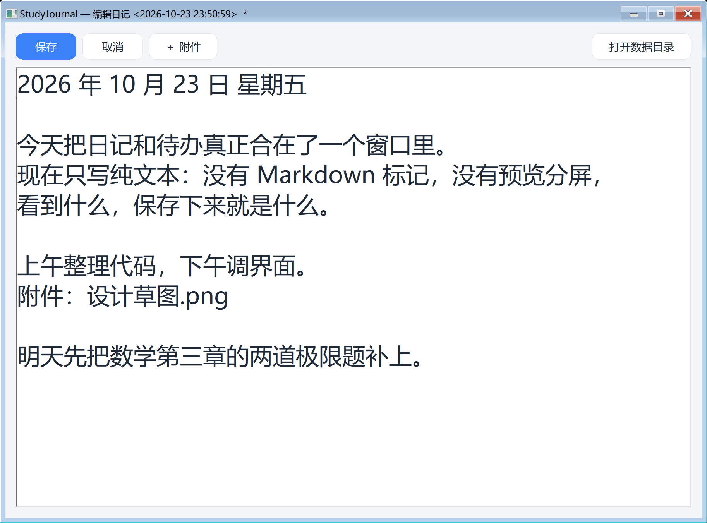
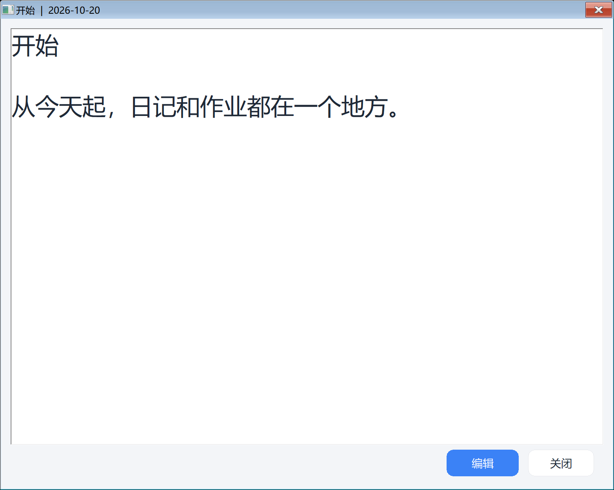
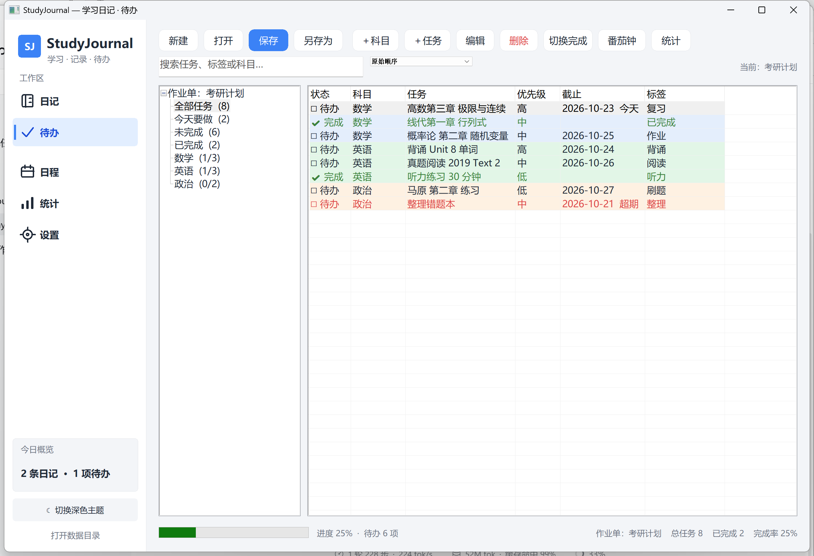

# StudyJournal 📚

**StudyJournal** 把两个原生 Win32 小工具合并成了一个应用：

- **DayJournal** —— 日历日记：月历、农历 / 节假日、日程倒数；
- **StudyTodo** —— 作业 / 学习待办：科目树、任务表、优先级与截止日期、番茄钟、进度统计。

合并后只有一个窗口、一套主题、一个数据目录：左边切换「日记 / 待办」，右边工作；日历会标出有日记、有日程、有待办到期的日子，侧边栏则汇总「今天」。

> 纯 Win32 API + C++17，零第三方依赖。
> **1.1 起日记改为纯文本**：不再解析或渲染 Markdown，编辑器就是一个多行文本框，看到什么，保存下来就是什么。

**启动方式**：发布版 `build\StudyJournal.exe` 目前**未签名**，直接双击时 Windows 可能按“未知发布者”提示；正式发布前请用你自己的代码签名证书签名，或用 `启动StudyJournal.bat` / 清除网络标记后运行。详见下文。









---

## 为什么这样合并

两个项目原本各自解决了「记录」和「执行」的一半问题，但数据、主题、窗口都是分开的。StudyJournal 的合并原则是：

1. **一个应用，而不是两个 exe 的启动器**：页面切换、主题、数据目录、备份全部共用；
2. **数据仍然开放**：日记和待办都是纯文本，随时可以用别的编辑器打开；
3. **保留原有习惯**：`entries/YYYY-MM-DD/HH-MM-SS.md` 的日记结构、`# 科目 / - 任务` 的作业单格式都与旧项目兼容；
4. **互相看得见**：待办到期日会显示在月历上，日记页会提示「今天有几项待办到期」，侧边栏显示今日概览。

---

## 功能

### 日记

- **月历主界面**：自绘月历，有日记用琥珀色短横线、有日程用橙色、有待办到期用绿色标记；今天高亮；
- **纯文本编辑**：一个多行文本框，所见即所存；没有 Markdown 工具条、没有右侧预览、没有公式 / 代码高亮；
- **附件**：选择文件后复制到 `attachments/日期/`，在正文光标处插入一行「附件：文件名」，不再嵌入图片；
- **查看窗口**：只读显示原始文本，底部可进入编辑；
- **日程与倒数**：生日 / 纪念日 / 考试 / 节日 / 提醒等分类，支持每年、每 N 年、单次、农历；
- **农历 / 节日 / 调休**：内置农历换算与节日表，联网按年同步放假与补班（断网回退内置表）；
- **统计、导出纯文本、导入旧 JSON**、每日整库备份（保留 7 份）、深 / 浅主题、高 DPI。

### 待办

- **科目树 + 任务表**：科目分组、状态、优先级、截止日期、标签一目了然；
- **就地编辑**：单击状态列完成 / 取消；双击任务文字直接改；双击科目列下拉换科目；右键快捷菜单；
- **筛选与排序**：全部 / 今天要做 / 未完成 / 已完成 / 按科目，关键词搜索，点表头排序；
- **多作业单**：新建、打开、另存为、删除，自动保存；
- **番茄钟**：25 分钟专注倒计时，非模态，不耽误继续看任务；
- **进度统计**：总体与各科目完成率，逾期任务在列表中红色显示；
- **兼容旧数据**：可直接读取 StudyTodo 的 GBK 文本作业单，保存时统一转为 UTF-8。

### 一体化细节

- 左侧导航统一进入：日记、待办、日程、统计、设置；
- 主题（7 套）同时作用于两个页面、编辑器和所有弹窗，`F12` 可快速切换深浅（[深色截图](docs/screenshots/tasks-dark.png)）；
- 「统计」汇总日记数量 / 字数 / 记录天数 + 待办完成率 / 今日到期 / 逾期；
- 每日备份同时包含 `entries/` 与 `tasks/`；
- 设置里更改数据目录时，旧目录内容会整体复制到新目录，并重新载入日记、作业单与日程。

---

## SmartScreen / 发布前签名

Windows 对 exe 的判断发生在程序启动前，依据是「文件来源标记（MOTW）+ 数字签名 + 应用信誉」，**和程序里有哪些功能无关**。

本仓库的发布产物 `build\StudyJournal.exe` 是**未签名**的：

- `build.bat` 不包含任何签名步骤，也不会写入证书；
- 仓库和发布包里不包含私钥或测试证书；
- 清除了 MOTW 也只能去除“下载标记”这一个触发条件；
- 未签名 exe 在开启了 SmartScreen 的电脑上仍可能提示“发布者未知”。

发布建议：

1. 使用你自己的代码签名证书签名（EV 证书通常可立即建立信誉，OV 证书需要积累）；
2. 签名后再分发，并保留时间戳；
3. 如果暂时不签名，接受用户首次运行时点「更多信息 → 仍要运行」，或让用户先运行 `清除网络标记.bat` / 使用 `启动StudyJournal.bat`；
4. 不要把本机测试证书或私钥打进发布包。

签名示例（需要自行安装 Windows SDK 的 `signtool`）：

```powershell
signtool sign /fd SHA256 /tr http://timestamp.digicert.com /td SHA256 /a StudyJournal.exe
```

本项目不会关闭 SmartScreen，也不会修改相关注册表。

---

## 数据目录

默认数据目录是 **exe 同级的 `data\`**（`build\data\`）。首次运行会自动创建；也可以在「设置 → 更改数据目录」里换位置。

```text
<数据根>/
├─ entries/                    # 每天一个目录，每条日记一个文件
│  └─ 2026-10-23/
│     ├─ 21-10-00.md
│     └─ 22-40-00.md
├─ attachments/                # 按日期存放附件
│  └─ 2026-10-23/
├─ tasks/                      # 作业单（纯文本，UTF-8）
│  ├─ 我的作业.txt
│  └─ 考研计划.txt
├─ backup/YYYYMMDD/            # 每日整库备份，保留最近 7 份
├─ schedules.txt               # 日程 / 倒数（TSV）
├─ lunar_fest.txt              # 自定义农历节日（可选）
└─ StudyJournal.meta.json      # 打开次数等元数据
```

exe 同级还有一个 `studyjournal_config.txt`，记录数据目录、主题、显示开关、上次作业单和页面：

```text
E:\StudyJournal\build\data
0
111
考研计划
1
```

### 日记文件

文件名沿用旧版的 `HH-MM-SS.md`，**内容就是纯文本**，不再做任何 Markdown 解析：

```text
2026 年 10 月 23 日 星期五

今天把日记和待办合在了一个窗口里。
现在只写纯文本：看到什么，保存下来就是什么。

附件：设计草图.png
```

保留 `.md` 扩展名是为了让旧数据、旧目录结构和旧脚本继续可用；如果你用别的编辑器打开，也只会看到普通文字。

### 作业单文件

作业单格式与 StudyTodo 完全一致：

```text
# 数学
- 高数第三章 极限与连续	@@PRI=2@@	@@DUE=2026-10-30@@	@@TAG=复习@@
+ 线代第一章 行列式
# 英语
- 背诵 Unit 8 单词	@@PRI=1@@	@@TAG=背诵@@
```

`-` 未完成、`+` 已完成；`PRI`（0 低 / 1 中 / 2 高）、`DUE`、`TAG` 为可选属性。

---

## 构建

需要 **MinGW-w64**（`g++`、`windres` 在 `PATH` 中；作者使用 g++ 16.2）。

```bat
build.bat
```

产物：`build\StudyJournal.exe`（**未签名**）。首次运行会在 exe 同级创建空的 `data\`；需要示例内容时，可自行把 `sample-data\` 复制为 `build\data\`。

`build.bat` 只编译和测试，不包含签名步骤；正式发布时请用你自己的证书签名，见“SmartScreen / 发布前签名”。

等价命令：

```bat
windres res\app.rc -O coff -o build\app_res.o
g++ -std=c++17 -O2 -o build\StudyJournal.exe src\*.cpp build\app_res.o ^
    -mwindows -lcomctl32 -lcomdlg32 -lole32 -lshell32 -ldwmapi -lwininet -lgdi32 -luser32
```

也提供 `CMakeLists.txt` 供 IDE / 其它工具链使用（`cmake -S . -B build-cmake`）。

## 发布前检查

发布包建议只保留：

```text
StudyJournal.exe
README.md
LICENSE
启动StudyJournal.bat / run.bat
清除网络标记.bat / unblock.bat / unblock-all.bat
sample-data/        （可选，发布时也可不放）
```

发布前请确认：

- `build\StudyJournal.exe` 由当前源码重新构建；
- **没有** `build\data\`、`studyjournal_config.txt`、测试产物或个人日记；
- 所有文件的 `Zone.Identifier` 已清除（运行 `清除网络标记.bat`，再用 `Get-Item -Stream Zone.Identifier` 复查）；
- exe 的 `Get-AuthenticodeSignature` 状态符合预期：未签名则为 `NotSigned`，使用自己的证书签名后应为 `Valid`；
- 记录最终 exe 的 SHA256，附在发布说明中；
- 不要发布本机测试证书、私钥或任何签名备份目录。

---

## 测试

```bat
g++ -std=c++17 -O2 -o build\test_core.exe ^
    src\encoding.cpp src\storage.cpp src\tasks.cpp tests\test_core.cpp ^
    -lgdi32 -lole32 -lshell32
build\test_core.exe
```

覆盖日记纯文本按条读写、旧日文件解析、作业单 UTF-8 / 旧 GBK 读取、任务属性与到期统计。`build.bat` 会自动编译并运行它。

---

## 从旧项目迁移

StudyJournal 尽量做到「把 exe 放过去就能继续用」：

- 如果 exe 旁已有 DayJournal 的 `dayjournal_config.txt`，会自动复制为 `studyjournal_config.txt` 并沿用原数据目录；
- 如果 `tasks\` 为空，会自动从 exe 同级或上一级的 `homework\` 导入 StudyTodo 作业单；
- DayJournal 旧的 `rili_data.dat` / `r.dat` + `s.dat` 迁移逻辑保留，会转成按条目的纯文本文件；
- 旧作业单可以是 GBK，读取时自动识别，保存后为 UTF-8；
- 旧日记里残留的 `#`、`**`、代码围栏等 Markdown 符号会按原样显示为普通文字，不会丢失；需要的话可以直接在编辑器里删掉。

---

## 快捷键

| 位置 | 按键 | 作用 |
| --- | --- | --- |
| 全局 | `F12` | 深色 / 浅色主题切换 |
| 日记页 | 双击列表条目 | 打开只读查看窗口 |
| 编辑窗口 | `Esc` | 关闭（有未保存内容会询问是否保存） |
| 待办表 | `Delete` | 删除选中任务 |
| 待办表 | `Space` | 标记完成 / 取消 |
| 待办表 | `F2` | 编辑选中任务 |
| 待办表 | 双击状态列 | 打勾 / 取消 |
| 待办表 | 双击任务 / 科目文字 | 就地编辑 / 换科目 |

---

## 项目结构

```text
StudyJournal/
├─ src/
│  ├─ app.h              # 共享声明：主题、日记、待办、页面接口
│  ├─ main.cpp           # 入口：DPI / 数据初始化 / 消息循环
│  ├─ main_window.cpp    # 主窗口：侧边栏、页面切换、统计概览
│  ├─ journal_page.cpp   # 日记页面：月历、列表、日记操作
│  ├─ tasks_page.cpp     # 待办页面：科目树、任务表、弹窗、番茄钟
│  ├─ tasks.cpp          # 待办数据层：作业单读写、统计
│  ├─ storage.cpp        # 日记存储：纯文本条目、配置、备份、旧数据迁移
│  ├─ editor.cpp         # 纯文本日记编辑器（附件插入正文）
│  ├─ viewwindow.cpp     # 日记只读查看窗口
│  ├─ calendar.cpp       # 农历、节日、联网节假日
│  ├─ schedules.cpp      # 日程 / 倒数
│  ├─ settings.cpp       # 设置窗口
│  ├─ encoding.cpp       # 编码与路径工具
│  ├─ buttons.cpp        # 主题、自绘按钮、配色刷新
│  └─ 字体 / 全局变量定义在 app.h
├─ res/                  # exe 清单（Common Controls v6 + PerMonitorV2 DPI）
├─ tests/test_core.cpp   # 无界面核心测试
├─ sample-data/          # 示例日记 / 作业单 / 日程
├─ docs/screenshots/     # README 截图
├─ build.bat
├─ 启动StudyJournal.bat  # 推荐入口：清标记 + 启动（避开 SmartScreen）
├─ run.bat               # 同上，英文文件名
├─ unblock.bat           # 拖入 exe 即可清除网络标记
├─ 清除网络标记.bat     # 中文入口：递归清理项目
├─ unblock-all.bat       # 递归清理整个项目文件夹
├─ CMakeLists.txt
└─ LICENSE
```

---

## 技术要点

- **单窗口 + 子页面**：主窗口只负责侧边栏与页面容器，日记 / 待办各自是 `WS_CHILD` 页面，主题变化通过 `WM_SJ_THEME` 广播；
- **纯文本编辑**：RichEdit 以 `TM_PLAINTEXT` 模式工作，只负责多行输入、滚动、撤销，不加载 RTF；
- **DPI**：manifest 声明 PerMonitorV2；若屏幕物理尺寸不足以容纳 2 倍缩放，会按工作区自动收敛 UI 缩放，避免窗口底部被任务栏遮住；
- **待办数据**：文本格式 + 行内 `@@KEY=VAL@@` 属性，既保持人可读，也兼容 v2；
- **零第三方依赖**：只链接系统 DLL（comctl32 / comdlg32 / ole32 / shell32 / dwmapi / wininet / gdi32 / user32）。

## License

[MIT](LICENSE)
